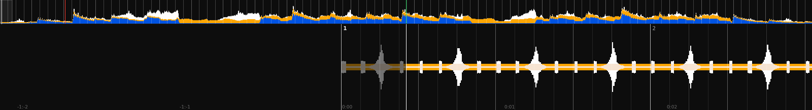
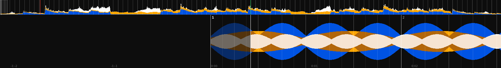

# perf-detail: cold waveform detail

Branch `perf-detail`. Metric: `bench_startup audio` on the 12 long files of the 10k fixture (`~/.cache/q50-perf/audio-load-10k.txt`), `waveform_detail_cold_ms` median plus process CPU, interleaved A/B, 4 rounds. The box was at load 11 to 40 on 16 cores, so CPU time is the steady number and wall is indicative only.

## Steps

| # | change | cold wall median (ms) | process CPU (s) | kept |
|---|---|---|---|---|
| 1 | cherry-pick hc-L3 meter commits (band filters as f64 pairs for `Meter` and `DetailMeter`, fold out of line, linear-curve `powf` skip; not the fused 4c2b2c4) | 600 -> 450 (-25%) | 24.0 -> 19.2 (-20%) | yes |
| 2 | `MAX_DECODE_THREADS` 6 -> 10 | 448 -> 385 on 16 cores, rounds 562/421/318/349 vs 440/549/456/424 | 19.0 -> 18.9 | no: noise-sized, only helps 12+ core machines, takes cores from UI and audio |

Serial split after step 1 (`bench_startup detail`, 12 files): decode 965 ms, `DetailMeter` 575 ms (962 ms before). Decode is symphonia and is 62% of the remaining work.

## Gates

- Detail bytes: unit tests from hc-L3 compare the new `Meter` and `DetailMeter` with the old sample-by-sample code bit for bit (mono to 6 channels, odd chunks); `bench_startup detail` reports `identical=8/12` on both the base and the new binary (the 4 differing files are m4a, a parallel-decode vs serial-decode difference that exists at baseline; both binaries show the same 4).
- `cargo test --workspace` green, `cargo check -p pioneer-test-ui --features dev-bins --bins` clean. `app/` untouched, so vitest, svelte-check and the Playwright smoke were not rerun.

## Not done, with reasons

- 800 -> 120 ms cold is not reachable by trimming: decode alone is 965 ms serial for 12 long files (about 80 ms per file per core, 6 threads give about 15 ms of the 37 ms per file wall floor only if the box is idle), plus the meter. A 120 ms open needs the series already stored: the analysis already warms it after the first partial result (`analysis_run.rs`, `warm_detail`), and `prefetch_waveform_detail` warms the selected and next tracks.
- Window first (decode only the visible window): the byte scale needs the band gains, which are the maximum of the whole track, so a window cannot be shown with the same look before a full pass. Not built.
- Progressive coarse-then-fine display: a visible change; not built. Option for Merlin: show the 150/s PWV overview (already stored by the analysis) scaled with approximate gains while the full series measures, behind a flag that is off.
- `expand_to_detail` 102 -> 50: harness waits three frames after the paint (docs section "expand to detail drawn is"), the JS side (`painted`) is 27-38 ms and already under 50. No app change.
- `analysis_first_result` 16.8 -> 5 s: model-bound; the detail warm only starts after the first partial result, so it is not on that path.
- `waveform_detail_cached` 2.5 -> 2 ms: measured 1.5 to 2.3 ms on the same runs for both binaries; a 4.5 MB file read, nothing to change.
- Fused meter 4c2b2c4: excluded by the brief; it would cut the analysis path, not the cold open (which runs only `DetailMeter`).

## Progressive cold open (Merlin approved, flag OFF by default)

With the flag on, the zoom view draws the stored 150/s columns (already scaled with the track's gains by the analysis) as soon as the track is loaded, instead of bare ground until the full 2400/s series arrives, then swaps the series in on the same canvas. Implementation: `ExpandedPlayer.svelte` passes `detailPending` as false while the flag is on; the display (`waveform-display.js` under prototyping/, untouched) already falls back to its 150/s columns when `detailPending` is false. With the flag off nothing changes: same props, same bytes, no backend change.

Flag: localStorage `ff.progressiveDetail` = `1` (same pattern as panel width and player height; the app has no dev-setting UI to join). Hidden toggle: click the build line in Settings > About 5 times; it then reads "... · progressive detail" and carries `data-progressive-detail="on"`. Off by default.

Time to first painted zoom waveform (Playwright, fixture backend with the series held for 450 ms, the measured cold median of the 10k long files; 3 runs):

| flag | run 1 | run 2 | run 3 |
|---|---|---|---|
| off | 853 ms | 866 ms | 936 ms |
| on | 28 ms | 22 ms | 38 ms |

Off is the 450 ms hold plus the harness's polling steps, on is the overview paint only. The real backend is not in this number (mock), so on a real open expect off = cold detail time + paint, on = paint.

Headless screenshots of the expanded wave (top strip is the overview, bottom the zoom view; same geometry, the zoom look changes when the series lands, which is the visible change that makes this a flag):

Gates: vitest all green (new `progressiveDetail.test.ts`), svelte-check 0 errors, Playwright smoke 195 passed / 47 skipped (two new tests: in-place swap with identical canvas box, and the timing above), `cargo test --workspace` unchanged and green.
